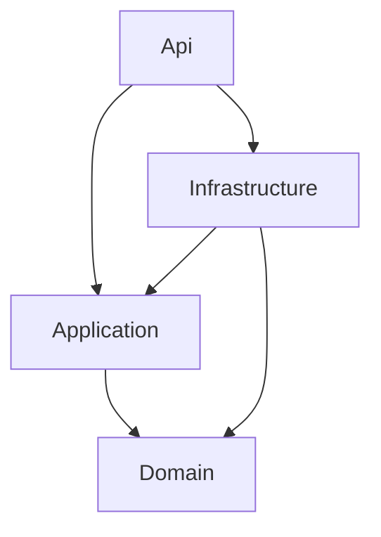

# Arquitectura inicial

HAQPOS contiene exclusivamente la base técnica de un futuro punto de venta hospitalario. No contiene módulos, entidades de negocio, migraciones, tablas públicas, datos de demostración, autenticación ni autorización.

## Capas y dependencias

- **Domain**: proyecto independiente, sin entidades ni dependencias externas.
- **Application**: referencia Domain; reservado para casos de uso futuros.
- **Infrastructure**: registro de persistencia con DI nativa, EF Core 10 y Npgsql. `HaqposDbContext` no contiene `DbSet`, entidades ni creación automática de esquema.
- **Api**: composición de servicios, Serilog JSON, OpenAPI en Development, ProblemDetails, `IExceptionHandler` y salud técnica.

No se utilizan repositorios genéricos, mediadores, servicios ficticios ni interfaces vacías. Los proyectos Domain y Application solo necesitan sus archivos de proyecto hasta que existan funcionalidades autorizadas.

## Salud, errores y configuración

`GET /api/health` devuelve `{"status":"ok"}` sin abrir conexiones a PostgreSQL. Permite comprobar la ejecución de la API aun sin base disponible.

`GET /api/health/database`, solo en Development, comprueba `Database.CanConnectAsync`. No modifica esquema ni datos. Un fallo devuelve ProblemDetails; los errores internos se registran y la respuesta no incluye trazas. `/openapi/v1.json` también está limitado a Development.

La cadena `ConnectionStrings:Haqpos` se obtiene de User Secrets o de `ConnectionStrings__Haqpos`. Las configuraciones versionadas solo contienen parámetros no sensibles. ASP.NET Core conserva su precedencia estándar: appsettings, archivo del entorno, User Secrets en Development, variables de entorno y argumentos.

El acceso habitual desde React comparte origen: Vite+ en desarrollo y Nginx en producción proxifican `/api`. No hace falta habilitar CORS. Si en el futuro se separan orígenes, se deberá configurar una lista explícita; no habilitar `AllowAnyOrigin` por defecto.

## Frontend

React estricto, React Router, TanStack Query, cliente HTTP con Fetch y alias `@/`. Una única pantalla muestra el texto solicitado e indica la disponibilidad de la API. No hay navegación empresarial.

Vite+ 1.3.0 administra el frontend con `vp`. `defineConfig`, `loadEnv` y `lazyPlugins` se importan de `vite-plus`; las pruebas de `vite-plus/test`. `vp check` ejecuta Oxfmt, Oxlint y comprobación de tipos con `typeAware` y `typeCheck`.

`pnpm-workspace.yaml` contiene únicamente los overrides oficiales de Vite y Vitest, sin paquetes workspace, catálogo ni monorepo JavaScript. El alias de `vite` a `@voidzero-dev/vite-plus-core@1.3.0` alinea los plugins con el Vite integrado; no instala una segunda herramienta independiente.

shadcn/ui queda inicializado manualmente según su documentación para proyectos existentes: `components.json`, alias, `cn()`, variables CSS y Tailwind 4. No se añadieron componentes de catálogo que la pantalla no necesita.

## Producción futura

Nginx sirve la SPA compilada y termina HTTPS. La API solo acepta encabezados reenviados desde la IP fija de Nginx, con un salto de confianza. PostgreSQL se encuentra en una red interna sin puertos publicados en el Compose de producción. El frontend solo publica HTTPS sobre loopback de manera predeterminada.

Vite+ se usa para compilar, comprobar y probar el frontend; no se ejecuta en el contenedor final de Nginx. Visual Studio administra la solución .NET independiente.

## Referencias oficiales consultadas

- [Vite+ completo](https://viteplus.dev/llms-full.txt), [inicio](https://viteplus.dev/guide/), [create](https://viteplus.dev/guide/create).
- [Dev](https://viteplus.dev/guide/dev), [build](https://viteplus.dev/guide/build), [check](https://viteplus.dev/guide/check), [Docker](https://viteplus.dev/guide/docker).
- [CLI local y overrides](https://viteplus.dev/guide/local-cli), [gestión de paquetes](https://viteplus.dev/guide/package-management).
- [Tailwind con Vite](https://tailwindcss.com/docs/installation/using-vite), [shadcn/ui en Vite](https://ui.shadcn.com/docs/installation/vite).
- [SDK .NET 10](https://dotnet.microsoft.com/en-us/download/dotnet/10.0), [errores ASP.NET Core](https://learn.microsoft.com/en-us/aspnet/core/fundamentals/error-handling?view=aspnetcore-10.0).
- [Proxies ASP.NET Core](https://learn.microsoft.com/en-us/aspnet/core/host-and-deploy/proxy-load-balancer?view=aspnetcore-10.0).
- [Imagen PostgreSQL](https://hub.docker.com/_/postgres), [pg_isready 18](https://www.postgresql.org/docs/18/app-pg-isready.html).
